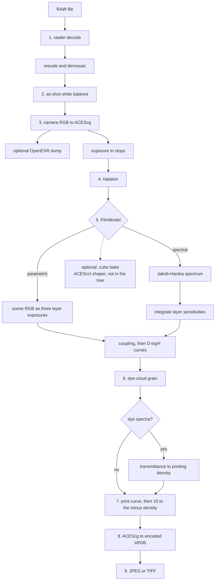

# Film pipeline

This is the path from a RAW file to a developed JPEG or TIFF. It is the
pipeline in [Architecture](ARCHITECTURE.md), filled in from the code.

`main` ends at the merge of
[#3](https://github.com/emperorpickles/rawstock/pull/3). That is rawler
decode, demosaic, as-shot white balance, the camera → ACEScg conversion,
and `dump-linear`. `rawstock develop` on `main` still exits with "not
implemented yet".

[#4](https://github.com/emperorpickles/rawstock/pull/4) (the parametric
pipeline and export) merged into the scene-linear stack branch, and
[#5](https://github.com/emperorpickles/rawstock/pull/5) (schema 1 TOML)
merged into the parametric stack branch. Neither merge is on `main`.
[#6](https://github.com/emperorpickles/rawstock/pull/6)
(`cursor/film-grain-halation-1141`, open against `main`) carries that
work, plus halation and the dye-cloud grain at `a883587`.
[#7](https://github.com/emperorpickles/rawstock/pull/7) stacks the spectral
model on the previous #6 and does not contain `a883587`.

| Where the code is | What it adds |
| --- | --- |
| `main` (#2 and #3) | Decode, demosaic, as-shot white balance, camera → ACEScg, OpenEXR dump |
| #6, from #4 | `FilmModel::Parametric`, print/scan, sRGB output, JPEG/TIFF export |
| #6, from #5 | Schema 1 TOML loader, `stocks/neutral.stock.toml` |
| #6 at `a883587` | Optional halation, and dye-cloud grain |
| #7 | `FilmModel::Spectral`, eye-tuned Portra 400. Its grain is the older per-cell hash |

The CPU entry point on #6 is `Pipeline::develop` in
`crates/rawstock-core/src/render.rs`. On `main` the working commands are
`inspect` and `dump-linear`. `develop` below is the #6 CLI:

```text
rawstock develop IMG.RAF --stock stocks/neutral.stock.toml -o out.jpg
rawstock dump-linear IMG.RAF out.exr
rawstock inspect IMG.RAF
```

There is no GPU path yet. The CPU path is the one a later wgpu port has to
match.

## Data flow



Solid arrows through print are `Pipeline::develop` on #6. The spectral
upsample and the dye-density print are #7, which has not rebased onto
`a883587`. The OpenEXR dump leaves before exposure. The `.cube` bake is
only a plan; nothing writes one.

## 1. rawler decode

**On `main`. Metadata is pull request #2. Demosaic is #3, which `main` includes.**

`rawler` is the decoder because it is pure Rust and the same crate can
compile for the CLI and for wasm. LibRaw is a contingency outside core, if
Fuji X-Trans quality turns out to be too low. It is not a dependency.

`RawImage::open` (`crates/rawstock-core/src/decode.rs`) calls
`rawler::decode_file` and keeps:

- width and height
- CFA kind: Fujifilm 6×6 X-Trans, 2×2 Bayer, or linear DNG (iPhone ProRAW,
  already demosaiced)
- EXIF orientation (applied later, at export)
- black and white levels
- as-shot white balance, four coefficients in RGBE order
- a camera color matrix, XYZ → camera RGBE

The matrix is `xyz_to_cam` when rawler filled it. Otherwise it is the first
DNG color matrix among illuminants D65, D50, D55, and A. A file that is
not X-Trans, Bayer, or linear DNG is rejected, as is a file with no levels
or no usable matrix.

`rawstock inspect` prints the metadata. #3 keeps the decoded image, so
`RawImage::develop_linear` in
`crates/rawstock-core/src/color.rs` runs rawler's `RawDevelop` with only
two steps:

1. `ProcessingStep::Rescale` normalizes black to 0 and white to 1.
2. `ProcessingStep::Demosaic` interpolates the mosaic. Bayer uses PPG,
   X-Trans uses bilinear, and a linear DNG passes through.

White balance, camera calibration, and sRGB stay out of rawler's develop
path. Those target a display encoding, and this stage has to stay
scene-referred. A four-channel or monochrome demosaic is an error. The
output is interleaved f32 RGB in camera space, still at sensor orientation.

## 2. As-shot white balance and exposure

**White balance is on `main` (#3). The exposure knob is on #6, from #4.** The architecture
lists them as one step. The code splits them, because they live in
different spaces.

**White balance** happens in camera RGB, inside `develop_linear`, before
the working-space matrix. The file's as-shot coefficients say how the
camera scaled red, green, and blue so a neutral surface in the scene
would land on equal camera RGB. They are divided by the green coefficient
so green stays 1. Rescale has already mapped a saturated photosite to
about 1, and a green coefficient of 1 leaves that green sample there. The
fourth (RGBE) coefficient is ignored, because demosaic returns three
channels. A missing, non-positive, or non-finite
coefficient is an error. The three scales are baked into the camera →
ACEScg matrix as a column scale, so each pixel is white-balanced and
converted in one multiply.

**Exposure** is `exposure_ev` on `Parameters`, applied by `apply_exposure`
at the start of `Pipeline::develop`. It is a stop correction: every
ACEScg sample is multiplied by `2^exposure_ev`. It runs after the OpenEXR
dump and before halation, still in scene-linear ACEScg. The neutral stock
uses 0. Portra 400 uses about −2.53, which places a scene value of 0.18 on
the log exposure the datasheet uses for ISO 400.

`dump-linear` does not apply `exposure_ev`. The architecture's "dump after
white balance and exposure" means the as-shot balance. The stock's stop
correction is part of development, not part of the dump.

## 3. Camera to ACEScg

**On `main` (#3).** `crates/rawstock-core/src/matrices.rs` and
`acescg_transform` in `color.rs`.

**ACEScg** is the working space for every creative stage. It is
scene-linear RGB: a sample is proportional to light in the scene, not to
the code value a monitor expects. The primaries are the Academy's AP1 set,
which is wide enough for most camera colors, and the white point is the
ACES white (near D60, not D65). A value may be above 1, for a highlight
brighter than that white, or slightly negative, for a color outside the
AP1 triangle. Those negatives are kept. Nothing clamps them here.

The conversion of one pixel is:

1. Take the file's XYZ → camera matrix and scale each row so D65 XYZ lands
   on camera `(1, 1, 1)`. As-shot white balance is defined the same way:
   it makes the scene neutral equal camera RGB. (dcraw normalizes toward
   equal-energy white; this code normalizes toward D65, because D65 is the
   source white of the next step.)
2. Invert that matrix. Camera RGB becomes CIE XYZ under D65.
3. Bradford-adapt from D65 to the ACES white. Bradford is a standard
   chromatic-adaptation matrix: it rescales the cone responses so one
   illuminant's white becomes another's.
4. Convert that XYZ to ACEScg with the AP1 matrix from SMPTE RP 177.

A singular camera matrix is an error. The constants cite Lindbloom / Lam
for Bradford, SMPTE ST 2065-1 and the ACEScg specification for the white
and the primaries.

`LinearImage::write_exr` writes this buffer as 32-bit float OpenEXR, channels
`R`, `G`, `B`, with no display transform. `rawstock dump-linear` refuses
any output that is not `.exr`. `lab/read_linear.py` (on `main`, from #3) reads it
back as a float32 NumPy array of shape `(height, width, 3)`. The lab does
not decode; it consumes this dump so a look and the Rust model see the
same pixels.

## 4. Halation and bloom

**Halation is on #6. Bloom is not a stage.**

The architecture names halation and bloom together, and the format sketch
on `main` (`stocks/example.stock.toml`) has a `[bloom]` table. Schema 1
has no bloom key, and `Pipeline::develop` never runs a second glow.
`Halation` is the only implementation. A stock that wants a neutral glow
sets similar red, green, and blue weights; a stock that wants a film-base
fringe sets red high.

Halation is light that bounces in the film base and re-exposes the
emulsion, usually as a red fringe around bright edges. It has to run on
linear exposure. A blur after the film curve, or after the sRGB encoding,
would spread display code values and would not behave like extra light.

`Halation::apply` (`stock.rs`), called from `Pipeline::develop` after
`exposure_ev`:

- Input and output are interleaved scene-linear ACEScg, same dimensions.
- The highlight measure is the peak of the three channels. Samples at or
  below `threshold` contribute nothing. The excess above the threshold is
  what gets blurred.
- The blur is three box passes whose variance matches a Gaussian, using
  the widths from Peter Kovesi, "Fast Almost-Gaussian Filtering" (DICTA
  2010). `radius` is the Gaussian sigma as a fraction of the shorter image
  side, so a preview and a full export get the same physical glow. A sigma
  below half a pixel is left unblurred. Edges repeat the border sample.
- The blurred excess is added back as `weight[channel] * glow`. Weights
  are non-negative. The blur is normalized, so a uniform field is
  unchanged by the blur itself.

Omit the `[halation]` table and the stage is skipped. Portra's table is a
faint red fringe: threshold 0.25 (middle gray after its exposure is about
0.03), radius 0.008, weights `[0.08, 0.008, 0.0]`.

## 5. The film model

**`FilmModel::Parametric` is on #6, from #4. `FilmModel::Spectral` is on #7.** Both
live in `crates/rawstock-core/src/stock.rs`. The enum is preferred over a
trait object: the two variants are known, and a `match` keeps the shared
tail obvious. `Spectral` is boxed so the wavelength tables do not inflate
every parametric stock.

A color negative has three stacked emulsion layers. Each layer records one
band of the spectrum and, after development, holds a silver or dye deposit.
**Density** is how dark that deposit is. Optical density is
`−log10(transmittance)`: density 1 lets through 10% of the light, density
2 lets through 1%. Density is the film's native unit. The model's job is
to turn scene light into three densities.

**D-logH** is the characteristic curve printed in a film datasheet. H is
exposure (illuminance times time). The plot is density on the vertical
axis against log10(exposure) on the horizontal. The toe is the shadow, the
middle is roughly straight, and the shoulder is the highlight roll-off.
`Curve` stores that plot as points `(log10(exposure), density)`.

### Shared curve math

`Curve::new` requires at least two points, finite values, strictly
increasing log exposure, and non-decreasing density. A flat shoulder is
legal. `Curve::eval` interpolates linearly in log exposure and clamps to
the end densities outside the first and last knot. Scene-linear ACEScg can
be zero or negative, and log10 of that is undefined, so each layer
exposure is lifted to `1e-6` before the log. Those pixels sit on the toe.

**Interlayer coupling** is the crosstalk between layers: light that exposes
one layer also affects its neighbors. When a stock sets it, a row-major
3×3 matrix multiplies the log-exposure column vector before the curves
run. Omit it and the layers stay independent. The matrix is not required
to be a color matrix in any particular space; it is just a mix of the
three log exposures. Portra's rows each sum to 1, so a neutral log
exposure is unchanged and the printer balance still holds for a gray.

`FilmModel::density` returns interleaved per-layer density, one sample per
input channel. A trailing incomplete pixel is dropped.

### Parametric

`FilmModel::Parametric` treats the three ACEScg channels as the three
layer exposures. Red scene light exposes the red layer, and the same for
green and blue. That is enough for a synthetic stock and for any look
defined as three curves. A measured emulsion uses the spectral variant.

Input is scene-linear ACEScg after halation. Output is density.

### Spectral

`FilmModel::Spectral` replaces only the step from scene RGB to per-layer
log exposure. The D-logH curves, the coupling matrix, and grain then run
exactly as they do for a parametric stock.

Real layers are sensitive to overlapping bands of wavelength, not to
ACEScg primaries. To use a datasheet sensitivity curve, the pixel has to
become a spectrum. That is the Jakob and Hanika upsample
(`crates/rawstock-core/src/spectrum.rs`): "A Low-Dimensional Function
Space for Efficient Spectral Upsampling", Computer Graphics Forum 38(2),
2019. A spectrum is a sigmoid of a quadratic polynomial in wavelength. The
three coefficients come from a lookup.

The table is `crates/rawstock-core/data/aces2065-1.coeff`, a resolution-64
ACES2065-1 (AP0) coefficient cube generated by mitsuba-renderer/rgb2spec.
The binary is about 9.4 MB. The generator's source is not vendored; the
BSD-3-Clause notice is in `data/NOTICE`. CIE 1931 and the D65/D60 tables
used beside it come from that project's `details/cie1931.h`.

`fill_scene_spectrum` does this for one pixel:

1. Negative and non-finite ACEScg channels become 0. A reflectance model
   has no negative samples, and the curve floor already covers the toe.
2. A near-neutral gray is a flat spectrum at that gray's level. The closed
   form does not depend on the table, so a neutral round-trips without
   lookup error.
3. Otherwise the pixel is converted from ACEScg (AP1) to ACES2065-1 (AP0),
   because the table was fit in AP0. A color inside the unit cube is
   fetched directly. A brighter color uses the scale extension: divide by
   the peak, look up, multiply the spectrum by the peak. Dividing a color
   that is already inside the cube looks up a brighter color the sigmoid
   often cannot match, so that case is left alone.
4. The sigmoid is evaluated on the stock's wavelength grid.

Each layer sensitivity is non-negative and integrates to 1 with the
trapezoidal rule on that grid. A flat spectrum of level 1 therefore
exposes every layer equally. Relative layer speed stays in the D-logH
curves, not in the sensitivity scale. Layer exposure is the dot product of
the spectrum and the pre-weighted sensitivity. That exposure then takes
the same `log10` → coupling → `Curve::eval` path as the parametric model.

## 6. Density-space grain

`Grain` and `Granularity` in `stock.rs`, rendered by `FilmGrain` in
`grain.rs`. Omit `[grain]` and the stage is skipped.

Grain is the density variation from dye clouds in the emulsion. It runs
after the film model and before print, in density. Adding the same noise
in ACEScg or in sRGB would follow the display encoding instead of how
dense the negative is.

### What was wrong

The previous field was a Poisson sum of compact ellipses, `(1 - d²)` inside
a hard edge, with per-layer radii of 70 / 48 / 34 µm on Portra and a 1 px
reconstruction blur. Measured on a neutral field at a 6160-wide pitch:

- Lag-1 autocorrelation was 0.98 and the high-frequency power was gone.
  The clumps were tens of pixels across. That is a stain, not Portra grain.
  Dye clouds on this film are about 10–25 µm (a few pixels on a 6K scan of
  35 mm), and they overlap.
- Red/green correlation was 0.73 and `(R−G)` was 0.76× the luma standard
  deviation. Shared centers used a different radius per layer, so each clump
  had a chromatic core and a ring of the other hue. The 20% private
  processes added more. Those colored blobs, cut by an object edge, read as
  halos and sudden hue jumps. The dye scan (`10^(−optical density)`) turns
  a density spike into a hue jump.
- There was no pixel grid. The periodogram had no spike. The blocky look
  was the older one-hash-per-48 µm-cell model. This one overshot the other
  way.
- Residual variance beside a hard density step already matched the flat
  field at that density (ratios 1.05 and 1.00). Grain is not sharpened, and
  the blur ran on the grain field before the RMS multiply, so it did not
  ring the picture. The "edge artifact" was the clump itself.

### Model

A gaussian shot-noise field, the high-overlap limit of the Boolean model in
Newson, Delon, and Galerne, "A Stochastic Film Grain Model for
Resolution-Independent Rendering", Computer Graphics Forum 36(8), 2017
(doi:10.1111/cgf.13159). Centers are a Poisson process in millimetres.
Each cloud is `A exp(−½ d²)`, truncated at 3.5σ. The code is an original
sum. It is not the Newson renderer, and it is not spektrafilm or darktable
(those are GPL, and this project does not copy them). What it takes from
that work is the construction: Poisson centers, compact grains, a filter
that stands in for the scanner.

Six processes, variances summing to 1 on each layer:

| Process | Variance | Sigma, in units of the reference size |
| --- | --- | --- |
| Fine, shared | 0.72 | 0.80–1.15 |
| Mid, shared | 0.20 | 1.70–2.50 |
| Coarse, shared | 0.03 | 3.20–4.60 |
| Private, per layer | 0.05 | 0.85–1.25 of that layer |

A shared process stamps one geometry on all three layers. The reference
size is the geometric mean of the three `size_mm` values, so a clump is
not a colored ring. The private process is the chroma, and it is the same
fine scale as the body of the grain, so the color is a tint in the grain
rather than a blotch. Aspect runs from 1 to about 1.6.

`size_mm` is that primary sigma, in millimetres. The default, and Portra,
is `[0.018, 0.013, 0.010]`: cyan dye coarsest, yellow dye finest, inside
the 10–25 µm dye-cloud range reported for this family of films. Below
about 0.75 px of sigma the photosite is the aperture and the cloud's whole
mass lands in the pixel that contains its center. Where a cloud sits inside
that pixel no longer matters, so the pixel's sum is drawn directly: a
Poisson count of clouds from a table, then their summed mass, gaussian
given the count. Above 64 clouds per pixel the count is gaussian too. The
draws hash the pixel's full-frame position, so a crop at the same pitch
matches the frame. This keeps a preview's cost per pixel. Drawing every
cloud took 5 to 6 s at the 1440 px proxy, because the frame holds about
100 million of them. The proxy's grain has the export's statistics but not
its individual clouds, which at that scale are smaller than a pixel. Above that, the
gaussian is evaluated and a 6 µm scanner aperture blurs the field. The crop
is padded by that kernel, so a 100% view matches the full frame.

The working sum is `f64`. A coarse pixel covers millions of clouds whose
masses sit below the unit in the last place of an `f32` total, and the
lost mass is a density bias (a 1×1 frame of Portra came out several tenths
dark and colored). The stored field is `f32` after the mean is removed.

The **48 µm aperture** still sets only the RMS amplitude. `Granularity`
stores `(density, rms)`. Density must strictly increase. RMS may rise and
fall. `cell_px = width * 0.048 / frame_mm`. While that window covers at
least one pixel, the density standard deviation is `rms / 1000`. Below one
pixel per aperture it scales with `sqrt(cell_px)`. RMS is evaluated at the
pixel's own density, after the field is built, so an edge does not grow
extra grain. The amount slider scales the tables and reuses the field.

`Grain::hash` is unchanged: the PCG hash of Jarzynski and Hill, integer
only, so a later WGSL port can match the draws. Mean density is unchanged
in expectation. The splatted field is normalized with the analytical mean
and variance, including the scanner's effect on `∫k²`.

## 7. Print/scan

**The per-channel print is on #6, from #4. The dye-spectrum print is on #7.**

A negative is dark where the scene was bright. Printing shines light
through it onto paper. This stage is that inversion, done in math, back
to scene-linear ACEScg. The primaries stay ACEScg until the output
transform. There is no paper color space.

`print_scan` in `render.rs`, for every density sample:

```text
print_log_exposure = print_exposure - density
print_density      = print_curve.eval(print_log_exposure)
linear             = 10 ^ (-print_density)
```

`print_exposure` is a log-exposure offset, the printer's exposure knob.
Subtracting density is the negative: a denser negative passes less light.
The print curve is another D-logH curve, with the same monotone rules. The
power of ten turns print density back into transmittance, which is treated
as display-referred linear RGB. "Display-referred" here means the values
are in the range a print would occupy, not that they are encoded for a
monitor yet.

A parametric stock, and a spectral stock with no dye curves, feeds
characteristic density straight into that function.

A spectral stock that stores `dye_density` does one extra conversion
first (`Spectral::printing_density`). Dye density is the spectral density
of one unit of that layer's characteristic density, on the same wavelength
grid. For each pixel the optical density at a wavelength is the sum of
`characteristic_density * dye` over the three layers. Transmittance is
`10` to the minus that sum. The transmittance is integrated against the
CIE 1931 2° observer under D65, then the existing D65 → ACEScg matrix
(`Observer::acescg_d65` in `spectrum.rs`). The weights are scaled so a
clear film (transmittance 1) is ACEScg `(1, 1, 1)`. Each ACEScg channel
becomes a density again with `−log10`. That density is what `print_scan`
sees.

The eye is the right reader for a slide, which is viewed. A negative is
read by a printer, whose red, green, and blue responses each sit on one
dye. A stock with `[scan_response]` (Portra 400 uses ISO 5-3 Status M)
scans with those responses instead (`Observer::from_responses`), each
normalized so clear film reads 1. With `[print_dye_density]` the print
stage then forms each channel's print density from that paper dye's
spectrum and views the sum under the same D65 observer
(`Spectral::print_pixel`), instead of taking `10^(−print density)` per
ACEScg channel. The paper dyes' side absorptions are what keep a
negative-print look from the oversaturation of ideal dyes.

`reference_log_exposure` is the datasheet printer balance. At load time
the curves are evaluated at that log exposure, the result is scanned
through the dyes, and a per-channel offset (`scan_balance`) is subtracted
so the three densities match their mean. One log exposure then prints
neutral. It is not a white balance measured from a photographed chart.
The offset is applied only when dye curves exist; setting it without them
is a load error. A wavelength grid that misses the visible observer is
also a load error, because the white normalisation would divide by zero.

## 8. Gamut compression and output transform

**The output transform is on #6, from #4. Gamut compression, beyond a clip, is not.**

`encode_srgb` in `color.rs` is the whole output transform:

1. Multiply by the ACEScg → linear sRGB matrix. That matrix Bradford-adapts
   from the ACES white onto the sRGB matrix white, then applies the IEC
   61966-2-1 primaries. ACEScg `(1, 1, 1)` maps to linear sRGB `(1, 1, 1)`.
2. Clip each channel to `0..=1`. A negative ACEScg value, or a color
   outside the sRGB triangle, is cut. The code comment calls this clip the
   gamut map.
3. Apply the IEC 61966-2-1 transfer function (the sRGB OETF). The result
   is encoded sRGB in `0..=1`, still at sensor orientation.

The architecture also lists Display P3 and a real gamut compression (a
smooth roll into the output gamut instead of a hard cut). Neither is in
the code. There is one output encoding, sRGB.

## 9. Export, and the optional .cube bake

**JPEG and TIFF export are on #6, from #4. The `.cube` bake is not in the tree.**

`SrgbImage::write` (`render.rs`):

- `.jpg` / `.jpeg` is 8-bit JPEG at quality 90. `.tif` / `.tiff` is 16-bit
  TIFF. Anything else, including PNG, is an error. The CLI checks the
  extension before it develops.
- EXIF orientation is baked into the pixels here. Development itself stays
  in sensor orientation, so a 90° file from the iPhone is rotated only as
  it is written.
- An sRGB ICC profile is embedded. `icc.rs` builds a small version-2.1
  profile: D50 media white, sRGB colorants Bradford-adapted to D50, and a
  sampled `curv` that is the inverse of the OETF above. Version 2.1 avoids
  a v4 parametric curve type.

### ACEScct `.cube` bake

A **3D LUT** is a lattice of input colors and the output color for each
one. A `.cube` file is the usual text form of that lattice. The plan on
`main` is that rawstock does not develop through a LUT. The film model
runs directly. A LUT is only an optional bake, for handing a look to
another program or for caching a preview.

**ACEScct** is the shaper that bake should use. It is the Academy's
logarithmic encoding of ACEScg. A short linear segment covers the deep
shadows, where a pure log falls apart, and the rest is logarithmic. A
uniform lattice in that encoding spends samples on the toe and on
highlights above the white point. A uniform lattice in linear ACEScg
spends almost all of its samples on highlights and starves the toe.
Typical scene values land where a `.cube` has nodes; the encoding itself
runs outside 0–1 for extreme highlights.

The bake, when it is written, is a side path around the per-pixel model:

1. Each lattice point is an ACEScct code value.
2. Decode ACEScct to scene-linear ACEScg.
3. Run the per-pixel stages: exposure, the film model, print/scan, and the
   output transform.
4. Store the encoded result in the `.cube`.

Halation and grain stay outside that lattice. Both read neighboring pixels
and the frame size. A 3D LUT has no coordinates and no neighbors, so it
cannot carry them. The develop path keeps running the model itself; the
file would be an export of the per-pixel look, not a replacement for
`Pipeline`.

No branch has an ACEScct encode or decode, a lattice size, or a `.cube`
writer. The `stock` module comment on `main` still talks about a base
`.cube` plus parameters. The plan superseded that comment: the stock is
the film model.

## Stock TOML schema

**Parametric schema 1 is on #6, from #5. Grain and halation keys are on #6.
Spectral keys are on #7.** The format sketch on `main`
(`stocks/example.stock.toml`, with `format_version` and a separate
`curves.json`) is not what the loader reads.

One TOML file per stock. `Stock::load` (`stock.rs`) reads it with serde.
`StockFile` and every nested table use `deny_unknown_fields`, so a typo
is a parse error rather than a silently ignored knob. `schema_version`
must be `1` (`Stock::SCHEMA_VERSION`). Any other version is
`StockError::UnknownVersion`. `revision` is the stock's own revision and
is a different number; the loader stores it and does not interpret it.

Required metadata, rejected if blank: `name`, `source`, `license`.
`model` is `parametric` or `spectral`. An unknown tag is a parse error.
`exposure_ev` and `print_exposure` are required because `Parameters`
needs them.

Each of `red`, `green`, `blue`, and `print` is two arrays,
`log_exposure` and `density`. Index `i` is one step-wedge reading, the
pair `(log_exposure[i], density[i])`. Paste a measured table into those
two columns. The loader does not resample. The arrays must be the same
length. Log exposure must strictly increase and density must not decrease,
the same rule as `Curve`. A custom deserializer accepts integers and
decimals, so a densitometer table can be copied without rewriting whole
numbers as floats.

Optional tables, all schema 1. Leaving one out is the same file an older
parametric stock already uses, so the version stays 1:

- `[coupling]` with a row-major `matrix`. Absent means independent layers.
- `[grain]` with `frame_mm` (default 35), `seed` (default 0), per-layer
  `density` / `rms`, and optional per-layer `size_mm`. Omitted sizes use
  0.018, 0.013, and 0.010 mm (red, green, blue), the primary dye-cloud
  sigma. Density must strictly increase; rms may rise and fall. The 48 µm
  aperture is not a file field.
- `[halation]` with `threshold`, `radius`, and `weight` of length 3.

`model = "spectral"` adds:

- `wavelength_nm`, strictly increasing, at least two samples. Shared grid,
  in nanometres.
- `[sensitivity]` red, green, and blue, one sample per wavelength.
  Non-negative, and each integrates to 1.
- `[dye_density]`, optional, same grid, non-negative. Absent keeps the
  per-channel print.
- `reference_log_exposure`, only legal together with dye curves.

A parametric file that sets any spectral key is `StockError::NotParametric`.
A spectral file that omits `wavelength_nm` or `sensitivity` is
`StockError::MissingSpectral`. Failures also cover an unreadable file, a
TOML error, unequal columns, and any `ModelError` from the curve, matrix,
grain, or spectrum checks.

`Stock` holds the metadata plus one `Parameters`. There is no second
parameter type. `into_parameters` is what the CLI passes to `Pipeline`.

`stocks/neutral.stock.toml` (on #6, from #5) is a synthetic reference: the same
D-logH curve on each layer, no coupling, no grain, no halation, license
CC0-1.0. The numbers were written for rawstock. They are not a measurement
of a manufactured film. A gray stays gray.

### Adding a stock

1. Copy `stocks/neutral.stock.toml` from the #6 branch, or write a file
   with `schema_version = 1`.
2. Set `name`, `source`, `license`, and `revision`. An invented look needs
   an original name. A file that transcribes one published film may use
   that film's name when `source` and `license` attribute the measurement.
   Trademarked names (Velvia, Portra, Classic Chrome, and the rest) are
   not for looks we made up. A parametric fit to a camera's film simulation
   may use that simulation's name when `source` says the file is an
   approximation of in-camera JPEGs, not the manufacturer's emulsion.
3. Set `model`. Fill `red`, `green`, `blue`, and `print` with step-wedge
   columns. Add `[coupling]`, `[grain]`, and `[halation]` only when the
   look uses them.
4. For a spectral stock, add `wavelength_nm` and `[sensitivity]`. Add
   `[dye_density]` and `reference_log_exposure` when the print should go
   through dye spectra. Sensitivities have to integrate to 1; put relative
   speed in the D-logH curves.
5. Develop with the file path:
   `rawstock develop IMG.RAF --stock path/to/look.stock.toml -o out.jpg`.
   The CLI takes a path, not a stock name from a search path.

`lab/import_spectral_film_lut.py` (on #7) can fill a spectral file from
the MIT-licensed Portra 400 module in
[Jan Lohse, spectral_film_lut](https://github.com/JanLohse/spectral_film_lut).
It reads the module as source text and does not vendor the package.
Re-running it overwrites `stocks/portra400.stock.toml` and drops the
eye-tuned values below. Grain and halation are left out of the importer
output.

## What the two models share

Both variants are a `FilmModel` inside the same `Parameters`, and
`Pipeline::develop` does not branch on them except to ask for density and,
optionally, a replacement printing density.

| Shared | Where it lives |
| --- | --- |
| `exposure_ev`, halation, grain, `print_exposure`, print `Curve` | `Parameters` |
| D-logH `Curve`, coupling matrix, `EXPOSURE_FLOOR` | `stock.rs` |
| Density in, print transmittance out | `print_scan` |
| sRGB encode, orientation, ICC, JPEG/TIFF | `color.rs`, `icc.rs`, `render.rs` |
| Schema 1 metadata, step-wedge columns, `deny_unknown_fields` | `Stock::load` |

Spectral-only data is the wavelength grid, sensitivities, optional dye
densities, `reference_log_exposure`, the Jakob-Hanika table, and the CIE
1931 / D65 observer. Spectral-only behavior is the upsample-and-integrate
step, and `printing_density` when dyes are present. Parametric stocks call
`FilmModel::printing_density` and get `None`, which means "use the
characteristic density as-is".

## Determinism and wasm

The pixel path is a function of the file, the stock, and the image
dimensions. Grain looks random and is not. `Grain::hash` draws the Poisson
count, the center, and the shape of each cloud from the cell coordinate, a
stream index, and the stock seed mixed with a per-process salt. Run it
twice on the same buffer and the pixels match. Preview and export share
that grain when they share a frame width, because the clouds are placed in
millimetres on `frame_mm`. The 48 µm aperture only scales the amplitude.
Halation's radius is a fraction of the shorter side, so its glow scales
the same way.

Nothing in the hash reads the clock, a thread id, or `rand`. The
coefficient table and the CIE tables sit behind `OnceLock` and are
constant after the first use.

Wasm constraints that already show up in the code and in CI:

- `rawstock-core` is `#![forbid(unsafe_code)]`.
- The decoder is rawler. LibRaw stays out of core so native and wasm do
  not diverge.
- rawler pulls in `uuid`, which has no OS randomness on
  `wasm32-unknown-unknown`. The crate enables `uuid`'s `js` feature on
  that target only (WebCrypto). CI runs
  `cargo check -p rawstock-core --target wasm32-unknown-unknown`. The
  open pipeline PRs keep that check.
- `Stock::load`, `write_exr`, and `SrgbImage::write` use `std::fs`. That
  compiles in the wasm check and does not work in a browser. A web front
  end has to pass bytes in and take bytes out. The web app still must not
  upload images; processing stays client-side.
- The spectral table is `include_bytes!` of a 9.4 MB file. A wasm build of
  the spectral model carries that table in the module.
- `exr` is on `main` (#3). `image` (jpeg and tiff only) joins the core
  crate on #6, from #4. Both are pure Rust. The wasm check is what guards
  them.
- The grain hash was written so a WGSL port can match it with integer
  ops. That port is not started.

## Calibration

The plan on `main` says the first spectral stock is Kodak Portra 400 from
publication E-4050, and that grain, interlayer coupling, and print/scan
are calibrated from chart or step-wedge scans. Lab and Rust are supposed
to agree on the model math within a numeric tolerance. That scan
calibration has not been done.

`stocks/portra400.stock.toml` on #7 keeps two kinds of numbers, and the
file says which is which.

From the datasheet, via the MIT-licensed spectral_film_lut transcription
(copyright 2026 Jan Lohse; license linked from `stocks/README.md` on that
branch):

- Spectral sensitivities, normalized so each layer integrates to 1.
- D-logH curves for the three layers. These are the E-4050 traces and are
  not altered. Highlights can stay slightly green because of that.
- Dye wavelengths, from that module's split of midscale spectral density
  minus D-min.
- `exposure_ev`, which places scene-linear 0.18 on the middle-gray log
  exposure spectral_film_lut uses for this ISO.
- `reference_log_exposure`, the datasheet printer balance.

Hand-tuned by eye, labeled **approximate aesthetic tuning** in the TOML
comments and in `source`. These are not densitometer readings, a paper
curve, or a published RMS table:

- Dye scales 1.45 / 0.98 / 0.95 (cyan / magenta / yellow), for pastel
  saturation, warmer skin, yellow-olive greens, and slightly cyan blues.
- A soft print curve with a long toe and a shallow shoulder, and
  `print_exposure` 1.28 so middle gray sits on the open part of that curve.
- Mild coupling, each row summing to 1.
- A Vision3-style RMS-versus-density grain shape (rises, then falls; blue
  grainiest) at a level chosen so grain is visible at 100% in an 8-bit
  JPEG. The magnitudes are higher than a real datasheet RMS, so the fine
  grain is still visible at 100%. `size_mm` is the primary dye-cloud sigma,
  18 / 13 / 10 µm. See the grain section.
- A faint red halation fringe. Portra has an anti-halation layer, so the
  effect is a fringe, not a glow.

The owner of #7 skipped chart-scan calibration. The committed file is a
best-effort feel, not a match to a printed Portra frame. agx-emulsion data
is not used. Portra is a Kodak trademark; this file is an attributed
transcription plus an eye-tuned print.

Chart or step-wedge calibration is still the plan: replace the tuned dye
scale, print curve, coupling, grain, and halation with measurements, and
check the Rust model against the lab on the same ACEScg dumps. Until that
happens, treat `portra400.stock.toml` as approximate. Re-running the
importer restores the un-tuned datasheet curves and deletes the eye-tuned
fields.

## Open questions

- **Gamut.** The output transform clips linear sRGB. A smooth gamut
  compression, and any output other than sRGB (Display P3 is named in the
  architecture), has no code.
- **Bloom.** The architecture and the format sketch on `main` name it.
  Schema 1 has halation only.
- **`.cube` bake.** ACEScct is the intended shaper. Lattice size, the
  exact ACEScct constants to implement, whether the baked range includes
  the sRGB OETF, and how a preview cache would be keyed are all open. No
  writer exists.
- **Stock lookup.** `--stock` is a path. Bundled versus user-installed
  stocks, and a `--stock <name>` search, are still open. The plan on
  `main` still shows `--stock <name>`.
- **Portra numbers.** Sensitivities and D-logH are E-4050. Dye scale,
  print, coupling, grain, and halation are eye-tuned. Chart calibration
  and a lab-versus-Rust numeric check are the unfinished part of phase 3
  in `docs/PLAN.md`.
- **X-Trans quality.** Demosaic is rawler's bilinear X-Trans path. Whether
  that is good enough, and when a desktop LibRaw fallback would exist
  outside core, is unchanged from the plan.
- **Export.** 8-bit JPEG and 16-bit TIFF with an sRGB ICC profile are
  implemented on #6, from #4. The open-question list on `main` still calls 16-bit
  TIFF and embedded ICC undecided. PNG, HEIF/AVIF, and a choice of output
  color space are still open.
- **GPU.** No wgpu pipeline. The grain hash is integer and has to match
  bit for bit. The cloud splat is floating-point and has to match the CPU
  sum. Halation's box blur has to match within the documented parity
  tolerance, which is not written down as a number yet.
- **Lab.** `read_linear.py` reads a dump. It does not run the film model,
  and there is no numeric comparison against Rust yet.
- **Licenses.** GPL-3.0-or-later for the program, with the rawler
  LGPL-2.1-only link still to be confirmed before a release. The Portra
  transcription is MIT because its source tables are MIT. The license for
  invented stock files is still undecided.
